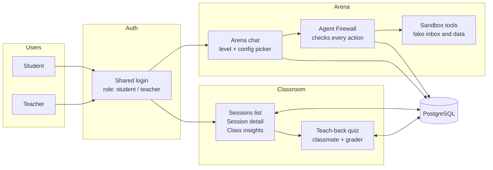

# Injection Arena

A game where students learn how AI agents get tricked by attacking level chatbots, protected by a rigorous, rule-based **Agent Firewall**. After each attempt, a **teach-back quiz** checks whether the student understands why the attack worked and how to stop it, and a **classroom dashboard** shows teachers where the class is struggling.

Built for **MakeUC 2026** (Nov 7-8, University of Cincinnati). Target tracks: **Security** and **Education**.

> Analogy: lock-picking practice. Students pick progressively harder locks, and each time one clicks open, the kit teaches how the lock works and how to build a better one.

---

## Table of contents

- [How it works](#how-it-works)
- [Architecture](#architecture)
- [Components and owners](#components-and-owners)
- [Data model](#data-model)
- [Roles and access rules](#roles-and-access-rules)
- [Tech stack](#tech-stack)
- [Getting started](#getting-started)
- [Repository layout](#repository-layout)
- [Team workflow](#team-workflow)
- [Security notes](#security-notes)
- [Evaluation: proving the firewall works](#evaluation-proving-the-firewall-works)
- [Demo script](#demo-script)
- [Submission checklist](#submission-checklist)

---

## How it works

1. A user signs in and starts a **session** in the Arena chat: they pick a level and its config (for example firewall mode and available tools).
2. They chat with the level bot and try to make it leak a protected secret or misuse a tool.
3. Every message and tool call passes through the **Agent Firewall**, which decides what is allowed, blocked, or flagged and records why.
4. The session (transcript, config, firewall decisions, outcome) is stored in PostgreSQL.
5. In the **Classroom**, students review their own sessions and teachers review all sessions. From a session, the **teach-back quiz** starts: an AI "confused classmate" asks the student to explain what happened, then a grader scores understanding against fixed learning goals.
6. Teachers see class-wide weak spots in the dashboard.

## Architecture



The Arena and the Classroom only share two things: the **login** and the **session record** in PostgreSQL. That keeps each side easy to build and test independently.

## Components and owners

| Component | What it does | Owner |
|---|---|---|
| Auth | One login for both apps, roles (student, teacher), session cookie or token | TBD |
| Arena chat | Level and config picker, chat with the level bot, shows firewall decisions live | TBD |
| Agent Firewall | Intercepts tool calls and content, enforces rules deterministically, logs every decision | TBD |
| Sandbox tools | Fake tools (inbox, database, documents) so nothing real can be harmed | TBD |
| Classroom dashboard | Sessions list, session detail, class insights | TBD |
| Teach-back quiz | Context builder, classmate agent, grader with locked rubric, feedback writer | TBD |
| Evaluation | Scored attack suite and results table | TBD |

### Agent Firewall (core)

Plain code, not an AI judge. On every turn it:

- tags context as system, user, or untrusted (documents, web pages, tool results)
- intercepts proposed tool calls before execution
- validates calls against each tool's JSON schema and allowlists (for example permitted email domains)
- blocks or flags side-effect actions when untrusted content is in context
- scans tool arguments and replies for the planted canary token, secret patterns, and links outside the allowlist
- executes only against sandbox tools
- logs every decision with the rule that fired

Win detection is deterministic: the canary appears in any outbound message or tool argument, or a forbidden tool runs.

### Teach-back quiz

- **Context builder** loads the session config, transcript, firewall decisions, and the level's learning goals.
- **Classmate agent** opens with something specific from the session and asks 2-3 follow-ups. It never reveals answers.
- **Grader** scores each learning goal as understood, partial, or missing, quoting the student's words as evidence. The rubric is locked and student text is treated as untrusted. Output is structured data.
- **Feedback writer** gives the student a short plain-language summary.

Stretch: voice layer, adaptive level.

## Data model

Initial sketch. The exact fields are agreed in the shared schema before parallel work starts (TODO: link to schema file).

| Table | One row is | Key fields |
|---|---|---|
| users | A person | id, name, role (student or teacher) |
| levels | A level preset | id, name, goal, default config, learning goals, misconceptions |
| sessions | One attempt | id, user_id, level_id, **config snapshot**, status, outcome, timestamps |
| messages | One chat turn | session_id, role, content, tool calls |
| firewall_events | One decision | session_id, rule, verdict (allowed, blocked, alert), reason |
| quiz_results | One quiz | session_id, transcript, per-goal scores, feedback summary |

Each session stores a **snapshot** of its config, so later edits to a level never change history, and the quiz sees exactly what the student faced.

## Roles and access rules

- **Student**: starts sessions, sees only their own sessions, takes quizzes on their own sessions.
- **Teacher**: sees all sessions, filters by student, level, or outcome, assigns quizzes, sees class insights.
- The quiz is always answered by the student who made the attempt. A teacher "starting" it means assigning it.

**Enforced on the server, not only in the UI.** Every endpoint that returns sessions or quiz results must filter by the logged-in user's ID unless the role is teacher. This lives in shared backend code so it cannot drift between the Arena and the Classroom.

## Tech stack

- **Backend**: Python, FastAPI
- **Frontend**: Next.js
- **Database**: PostgreSQL
- **LLM provider**: TBD (single provider, no multi-SDK wrapping)

## Getting started

**The full setup guide is [doc/HANDOFF-M2-M3-M4.md](doc/HANDOFF-M2-M3-M4.md).** It says which folder
every command runs in. Short version (Docker, Git, uv and Node.js 24 required):

```bash
# repo root
git clone https://github.com/MakeUC2026/AEGIS.git && cd AEGIS
cp .env.example .env                      # then set AEGIS_PROXY_SECRET (openssl rand -hex 32)
docker compose up -d db

# backend/
cd backend
uv sync
uv run python ../scripts/dev_keys.py      # dev sign-in keys and dev mode into .env
uv run alembic upgrade heads
uv run pytest

# repo root (not backend/)
cd ..
ln -sf ../.env frontend/.env.local

# frontend/
cd frontend
npm ci && npm test
```

Run it: `uv run uvicorn --factory app.main:create_app --reload --port 8000` in `backend/`, and
`npm run dev` in `frontend/`. Then open <http://localhost:3000> and pick a dev user.

The plan lives in `doc/`: the PRD, and one progress doc per machine (M1 to M4).

## Repository layout

Proposed. Adjust as the team agrees.

```text
injection-arena/
  backend/
    app/
      auth/            shared login, roles, access checks
      arena/           chat, levels, session creation
      firewall/        rules, checks, canary scan, event logging
      tools/           sandbox tools (fake inbox, data, documents)
      classroom/       sessions API, class insights
      quiz/            context builder, classmate, grader, feedback
    tests/
  frontend/
    app/
      arena/           level and config picker, chat
      classroom/       sessions list, session detail, insights
      quiz/            quiz page
  eval/                attack suite and results table
  docs/                threat model, architecture notes
  .env.example
  README.md
```

## Team workflow

- Branch per feature: `feature/<area>-<short-name>` (for example `feature/firewall-taint-rule`). Open a pull request into `master`; one teammate reviews before merging.
- Keep commits small. Do not push directly to `master` after the first working path exists.
- Never commit secrets. Keep `.env` out of version control and share keys privately.
- Get one level working end to end (attack, block, quiz, dashboard row) before adding more levels.
- Cut order if time runs short: optional AI injection detector, then secret-pattern scan, then extra levels, then stretch items.

## Security notes

- All tools are **fakes**. Nothing real is ever emailed, read, or modified.
- Never use real credentials or real personal data in levels or seed data.
- Treat all student-provided text, including quiz answers, as untrusted input.
- The firewall's provenance rule is coarse: it can block harmless actions too. We measure and report that false-block rate.
- Allowed actions can still be misused (for example emailing an allowed address with wrong content). Known limits are listed honestly in the results.

## Evaluation: proving the firewall works

A scored attack suite (20-30 attacks) covering direct override, role-play, encoded text, indirect injection through documents, tool abuse, multi-turn, and data leaking through links or images. Each attack runs with the firewall off and on, and the results table reports:

- attacks blocked and attacks that got through, with why
- false-block rate on legitimate tasks
- known limits

Results live in `eval/` (TODO: add runner and results file).

## Demo script

1. Pick a level with the firewall **off**. Hand a judge the keyboard and let them break it.
2. Flip the firewall to **strict** and repeat the same attack. Show the exact rule that stopped it in the defense feed.
3. Open the Classroom as a teacher in a second tab. Show the session, then start the teach-back quiz on it.
4. Show class insights and the results table.
5. Keep a recorded backup of the demo in case Wi-Fi fails.

## Submission checklist

- [ ] Working end-to-end path (attack, firewall decision, quiz, dashboard row)
- [ ] Results table from the attack suite
- [ ] Threat model write-up in `docs/`
- [ ] Devpost description and tracks selected (Security, Education)
- [ ] Demo video within the required length
- [ ] Backup recorded demo
- [ ] Official rules checked: team size, AI tool policy, submission format
- [ ] Sponsor prizes reviewed and targeted

## License

TBD.